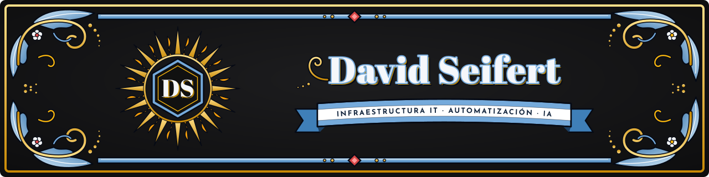

Trabajo en IT hace más de 10 años. Hoy soy responsable de las redes de 6 sedes en 4 países y de un sistema de más de 150 cámaras. En los últimos años sumé automatización e inteligencia artificial aplicadas a la operación de IT, con n8n como orquestador.

<h2></h2>

- **Redes e infraestructura:** switching y VLAN, firewalls, VPN, WiFi, monitoreo y videovigilancia.
- **Automatización:** flujos en n8n que conectan el monitoreo, la mesa de ayuda y otros sistemas por API.
- **IA aplicada:** agentes y asistentes para procesos internos, y su conexión con sistemas de la empresa mediante MCP.

<h2></h2>

| Proyecto | Qué es | Estado |
|---|---|---|
| Agrupador de alertas PRTG → InvGate | Automatización en n8n que junta en un solo ticket todas las alertas de un mismo corte. Bajó de más de 50 tickets por corte a menos de 10. | En producción. Repositorio privado |
| Asistentes de IA para Recursos Humanos | Agente de IA para selección de personal que analiza CV y arma preguntas de entrevista, presentado a la dirección de la empresa, y piloto de asistentes de IA para el área de Capital Humano. | En curso, en etapa de planificación |
| [Sistema multiagente en n8n](https://github.com/david6sei/sistema-multiagente-n8n) | Asistente personal con router, 9 especialistas, 22 herramientas, crítico y aprobación humana. Cuesta alrededor de US$8 por mes (medido en agosto de 2026). | Proyecto personal, en uso diario |
| GastaTutti Pro | Aplicación web de finanzas personales. Escanea tickets y facturas con IA mediante un flujo de n8n y muestra gastos y presupuestos en un tablero. Hecha con Next.js, TypeScript, SQLite y Docker, publicada detrás de Cloudflare Zero Trust. | Proyecto personal, en uso diario. Repositorio privado |
| Home lab con Home Assistant | Domótica de mi casa sobre una Raspberry Pi 5 con Docker: Home Assistant, MQTT, Node-RED y n8n, con unos 35 dispositivos y un panel de pared. Es también mi banco de pruebas antes de llevar algo al trabajo. | Proyecto personal, en uso diario |

<h2></h2>

**Redes:**    

**Infraestructura:**      

**Automatización e IA:**      

**Monitoreo y servicios:**   

**Home lab:**   

<h2></h2>

- Coderhouse: Certificación en AI Automation Avanzado (2026)
- Dell EMC Specialist: Technology Architect, Midrange Storage (2018)
- Dell EMC Associate: Information Storage and Management (2018)

<h2></h2>

[LinkedIn](https://www.linkedin.com/in/david6seifert) · david6sei@gmail.com
